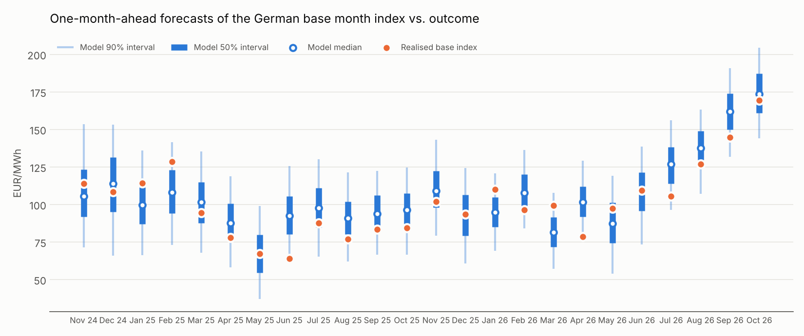
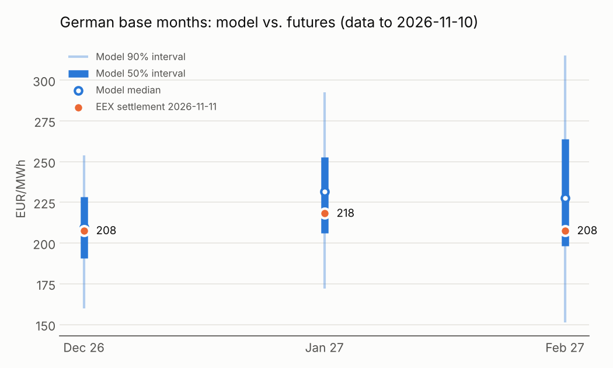

# German base month model, version 1

Generated by `python -m models.de_base_month --backtest 24` and `python -m models.report_de_base_month --model v1`.
Data through 2026-11-10; EEX futures as of 2026-11-11.

## What the model does

It models the daily German day-ahead base price as a weekly-varying **price level**, plus a weekly-varying
**merit-order slope** times standardised residual load (load minus wind and solar), plus a weekend effect,
with heavy-tailed (Student-t) noise whose scale also varies week to week. All three weekly states are random walks.
A delivery month is forecast by carrying the states forward along their random walks and drawing residual load
from the same calendar month of the last 3 years, then averaging simulated daily prices into the month index
that a German base month future settles against.

It does not see gas or carbon prices. The weekly level stands in for them, so the model knows
"prices are high right now" but not "the gas curve says they will fall next quarter".

## Fit

306 weeks of data, 8 s of sampling, 0 divergences.

| Parameter | Posterior mean | 90% interval |
|---|---|---|
| Weekly change in level (s.d.), EUR/MWh | 10.45 | 9.49 to 11.47 |
| Weekly change in slope (s.d.) | 7.86 | 6.87 to 8.88 |
| Current level, EUR/MWh | 212.61 | 195.00 to 230.65 |
| Current slope, EUR/MWh per s.d. of residual load | 60.86 | 48.34 to 72.70 |
| Current daily noise scale, EUR/MWh | 18.02 | 11.31 to 27.23 |
| Weekend effect, EUR/MWh | -1.90 | -2.67 to -1.17 |
| Student-t degrees of freedom | 4.90 | 3.89 to 6.19 |

## Backtest: 24 one-month-ahead forecasts

Refit at each month end, forecast the next month's base index.

| | Model | Naive (last 30 days) |
|---|---|---|
| Mean absolute error | 11.6 EUR/MWh | 14.0 EUR/MWh |
| 50% interval coverage | 58% (target 50%) | |
| 90% interval coverage | 100% (target 90%) | |
| Mean CRPS | 8.3 | |

| Month | Realised | Model mean | Model 90% | Naive | EEX futures at origin | PIT |
|---|---|---|---|---|---|---|
| Nov 24 | 113.9 | 108.4 | 71.3 to 153.4 | 86.7 |  | 0.63 |
| Dec 24 | 108.3 | 112.6 | 66.0 to 153.3 | 113.9 |  | 0.42 |
| Jan 25 | 114.1 | 100.7 | 66.4 to 135.9 | 108.8 |  | 0.76 |
| Feb 25 | 128.5 | 107.7 | 73.2 to 141.5 | 117.9 |  | 0.84 |
| Mar 25 | 94.6 | 101.1 | 67.7 to 135.2 | 129.0 |  | 0.37 |
| Apr 25 | 77.9 | 88.2 | 58.2 to 118.8 | 93.6 |  | 0.28 |
| May 25 | 67.3 | 67.4 | 37.0 to 98.9 | 77.9 |  | 0.51 |
| Jun 25 | 64.0 | 93.2 | 62.1 to 125.6 | 68.1 |  | 0.07 |
| Jul 25 | 87.8 | 98.0 | 65.3 to 130.2 | 64.0 |  | 0.30 |
| Aug 25 | 77.0 | 91.5 | 62.1 to 121.4 | 86.1 |  | 0.20 |
| Sep 25 | 83.5 | 94.3 | 66.6 to 122.4 | 76.5 |  | 0.27 |
| Oct 25 | 84.5 | 96.1 | 66.4 to 124.7 | 83.5 |  | 0.25 |
| Nov 25 | 101.9 | 109.8 | 79.3 to 143.1 | 83.4 |  | 0.32 |
| Dec 25 | 93.5 | 92.7 | 60.7 to 124.4 | 101.9 |  | 0.53 |
| Jan 26 | 110.1 | 94.6 | 69.1 to 120.7 | 93.5 |  | 0.84 |
| Feb 26 | 96.6 | 109.2 | 84.0 to 136.4 | 113.4 |  | 0.23 |
| Mar 26 | 99.2 | 81.6 | 57.1 to 107.6 | 97.6 |  | 0.89 |
| Apr 26 | 78.5 | 102.0 | 76.2 to 129.2 | 100.8 |  | 0.06 |
| May 26 | 97.5 | 87.4 | 54.1 to 119.1 | 78.5 |  | 0.69 |
| Jun 26 | 109.5 | 108.0 | 73.5 to 138.6 | 100.9 |  | 0.51 |
| Jul 26 | 105.4 | 126.5 | 96.4 to 156.0 | 109.5 |  | 0.11 |
| Aug 26 | 126.9 | 136.7 | 107.2 to 163.4 | 103.9 |  | 0.28 |
| Sep 26 | 144.8 | 161.5 | 131.6 to 190.7 | 127.1 |  | 0.18 |
| Oct 26 | 169.5 | 173.9 | 144.1 to 204.6 | 144.8 | 161.3 | 0.41 |

**What this says.** The model beats the naive forecast by 17% on absolute error. Its intervals are too wide rather than too narrow (90% intervals caught 100% of outcomes), the safer failure. It leans high on average by 4.5 EUR/MWh, mostly in months where prices fell, because it has no fuel prices to tell it a decline is coming. The lean is seasonal: +12.7 EUR/MWh from June to October against -1.3 in the other months. In summer, solar pushes gas out of the price-setting position for many hours, and the model has no seasonal term to expect that.

PIT is the share of model draws below the outcome; for a calibrated model these are spread evenly between 0 and 1.
Futures at origin are only available from late September 2026, when the scraper started.

## Forward months vs. EEX futures

| Month | Model mean | Model 50% | Model 90% | EEX settlement | Share of model draws below futures |
|---|---|---|---|---|---|
| Dec 26 | 209.0 | 190.7 to 228.2 | 159.9 to 253.9 | 207.7 | 47% |
| Jan 27 | 230.8 | 206.2 to 252.8 | 172.2 to 292.5 | 218.4 | 36% |
| Feb 27 | 230.7 | 198.2 to 263.8 | 151.3 to 315.3 | 207.7 | 32% |

The last column is the model's probability that the month settles below the current futures price.
Around 50% means model and market agree; well above 50% means the model thinks futures are rich.

## Next improvements

1. A seasonal term (by calendar month) on the price/cost multiple, for the summer over-forecast.
2. Use the futures curve itself as an input once enough history builds up, and model the risk premium
   (futures minus realised) directly.
3. Trend in residual load: recent years are sampled with equal weight, but renewable capacity keeps growing.
4. Coal and imports: when gas is not the marginal plant, the price/cost multiple has to absorb it.
