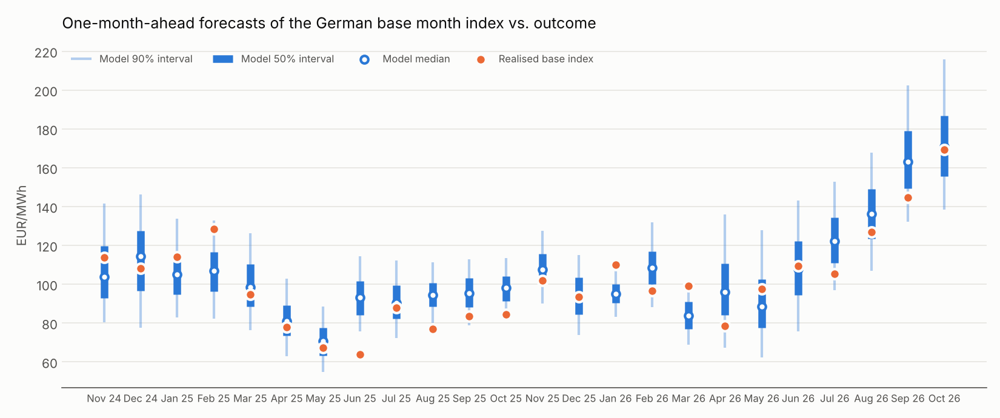
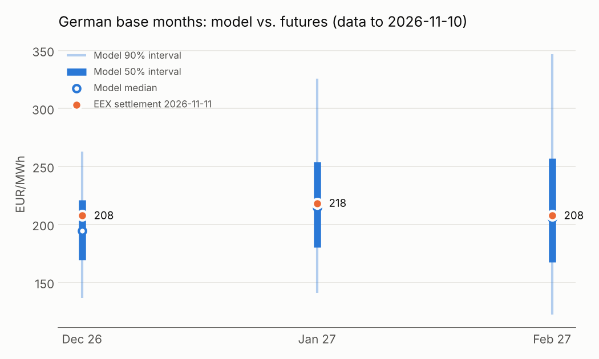

# German base month model: Version 2: gas and carbon

Generated by `python -m models.de_base_month_v2 --backtest 24` and `python -m models.report_de_base_month --model v2`.
Data through 2026-11-10; EEX futures as of 2026-11-11.

## What the model does

Version 2 ties the price to the **cost of gas-fired power**: TTF gas plus the carbon cost of burning it,
divided by a 50% plant efficiency. The daily price is that cost times a weekly-varying **multiple**, plus a
weekly-varying slope on standardised residual load (also scaled by the cost), plus a weekend effect, with
heavy-tailed noise that partly scales with the cost. The multiple and slope are random walks, so the model still
adapts when coal, renewables or imports take over price setting, but a move in gas now moves its forecast
straight away.

A delivery month is forecast from the **TTF futures price for that month** and the EUA December future, with
gas-price uncertainty that grows with time to delivery (volatility from the last 60 days of TTF), and residual
load drawn from the same calendar month of the last 3 years. In the backtest, where old TTF contract prices are
not available, the TTF front month at the forecast date stands in for the delivery month's gas price.

## Fit

306 weeks of data, 9 s of sampling, 0 divergences.

| Parameter | Posterior mean | 90% interval |
|---|---|---|
| Weekly change in price/cost multiple (s.d.) | 0.04 | 0.04 to 0.05 |
| Weekly change in slope (s.d.) | 0.04 | 0.03 to 0.05 |
| Current price/cost multiple | 0.96 | 0.88 to 1.03 |
| Current slope, multiple per s.d. of residual load | 0.32 | 0.25 to 0.38 |
| Share of volatility that scales with fuel cost (0 to 1) | 0.79 | 0.59 to 0.94 |
| Weekend effect, EUR/MWh | -1.61 | -2.39 to -0.85 |
| Student-t degrees of freedom | 4.25 | 3.56 to 5.04 |

## Backtest: 24 one-month-ahead forecasts

Refit at each month end, forecast the next month's base index.

| | Model | Naive (last 30 days) |
|---|---|---|
| Mean absolute error | 10.7 EUR/MWh | 14.0 EUR/MWh |
| 50% interval coverage | 54% (target 50%) | |
| 90% interval coverage | 88% (target 90%) | |
| Mean CRPS | 7.8 | |

### All versions on the same months

| | Version 1: price level only | Version 2: gas and carbon (this report) | Variant: v2 + today's solar fleet | Variant: v2 + calendar-month term | Version 3: v2 + today's solar fleet + calendar month |
|---|---|---|---|---|---|
| Mean absolute error, EUR/MWh | 11.6 | 10.7 | 9.2 | 9.7 | 9.1 |
| Mean error (bias), EUR/MWh | +4.5 | +4.6 | -2.7 | +4.6 | -2.6 |
| Bias June to October, EUR/MWh | +12.7 | +12.6 | +2.2 | +9.1 | -1.3 |
| 50% interval coverage | 58% | 54% | 50% | 58% | 58% |
| 90% interval coverage | 100% | 88% | 88% | 96% | 92% |
| Mean CRPS (lower is better) | 8.3 | 7.8 | 6.8 | 7.2 | 6.6 |

Naive forecast (last 30 days) error: 14.0 EUR/MWh.

| Month | Realised | Model mean | Model 90% | Naive | EEX futures at origin | PIT |
|---|---|---|---|---|---|---|
| Nov 24 | 113.9 | 107.2 | 80.4 to 141.7 | 86.7 |  | 0.66 |
| Dec 24 | 108.3 | 112.8 | 77.5 to 146.2 | 113.9 |  | 0.39 |
| Jan 25 | 114.1 | 105.7 | 82.9 to 133.7 | 108.8 |  | 0.73 |
| Feb 25 | 128.5 | 107.0 | 82.2 to 132.9 | 117.9 |  | 0.92 |
| Mar 25 | 94.6 | 99.9 | 76.4 to 126.1 | 129.0 |  | 0.41 |
| Apr 25 | 77.9 | 81.8 | 62.9 to 102.9 | 93.6 |  | 0.41 |
| May 25 | 67.3 | 70.7 | 54.7 to 88.6 | 77.9 |  | 0.40 |
| Jun 25 | 64.0 | 93.6 | 75.6 to 114.5 | 68.1 |  | 0.00 |
| Jul 25 | 87.8 | 91.0 | 72.2 to 112.4 | 64.0 |  | 0.43 |
| Aug 25 | 77.0 | 94.9 | 79.6 to 111.4 | 86.1 |  | 0.03 |
| Sep 25 | 83.5 | 95.7 | 78.7 to 112.8 | 76.5 |  | 0.13 |
| Oct 25 | 84.5 | 97.6 | 81.4 to 113.3 | 83.5 |  | 0.10 |
| Nov 25 | 101.9 | 108.1 | 90.0 to 127.5 | 83.4 |  | 0.32 |
| Dec 25 | 93.5 | 93.9 | 74.0 to 115.0 | 101.9 |  | 0.52 |
| Jan 26 | 110.1 | 95.2 | 83.3 to 107.8 | 93.5 |  | 0.97 |
| Feb 26 | 96.6 | 108.9 | 88.3 to 131.8 | 113.4 |  | 0.17 |
| Mar 26 | 99.2 | 84.6 | 68.7 to 101.2 | 97.6 |  | 0.92 |
| Apr 26 | 78.5 | 98.8 | 67.2 to 135.9 | 100.8 |  | 0.16 |
| May 26 | 97.5 | 91.0 | 62.4 to 128.0 | 78.5 |  | 0.68 |
| Jun 26 | 109.5 | 108.6 | 75.7 to 143.1 | 100.9 |  | 0.53 |
| Jul 26 | 105.4 | 123.1 | 96.9 to 152.9 | 109.5 |  | 0.16 |
| Aug 26 | 126.9 | 136.6 | 106.9 to 167.7 | 103.9 |  | 0.32 |
| Sep 26 | 144.8 | 165.0 | 132.3 to 202.5 | 127.1 |  | 0.17 |
| Oct 26 | 169.5 | 172.9 | 138.6 to 216.0 | 144.8 | 161.3 | 0.48 |

**What this says.** The model beats the naive forecast by 24% on absolute error. Its 90% intervals caught 88% of outcomes and its 50% intervals 54%, close to the targets. It leans high on average by 4.6 EUR/MWh. The lean is seasonal: +12.6 EUR/MWh from June to October against -1.2 in the other months. Its residual-load scenarios come from past years, which had less solar, so they overstate summer residual load; version 3 fixes this.

PIT is the share of model draws below the outcome; for a calibrated model these are spread evenly between 0 and 1.
Futures at origin are only available from late September 2026, when the scraper started.

## Forward months vs. EEX futures

| Month | Model mean | Model 50% | Model 90% | EEX settlement | Share of model draws below futures |
|---|---|---|---|---|---|
| Dec 26 | 196.6 | 169.7 to 221.1 | 136.6 to 262.8 | 207.7 | 64% |
| Jan 27 | 221.2 | 180.1 to 254.0 | 140.9 to 325.9 | 218.4 | 53% |
| Feb 27 | 217.4 | 167.4 to 257.2 | 122.3 to 347.1 | 207.7 | 52% |

The last column is the model's probability that the month settles below the current futures price.
Around 50% means model and market agree; well above 50% means the model thinks futures are rich.

## Next improvements

1. A seasonal term (by calendar month) on the price/cost multiple, for the summer over-forecast.
2. Use the futures curve itself as an input once enough history builds up, and model the risk premium
   (futures minus realised) directly.
3. Trend in residual load: recent years are sampled with equal weight, but renewable capacity keeps growing.
4. Coal and imports: when gas is not the marginal plant, the price/cost multiple has to absorb it.
